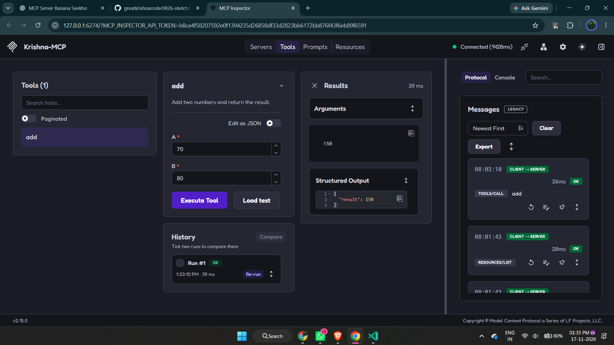

# MCP Server hota kya hai?

> AI ko tumhare computer par files padhni hain, calculator chalana hai ya kisi API se data lena hai.MCP ek standard tareeka deta hai jisse AI applications, tools aur data sources ke saath communicate kar sakti hain.


> MCP server khud AI model nahi hai. Ye AI application aur tools/data ke beech ek standardized bridge hai.

```
mkdir MCP-Learning — project ka folder banata hai.


cd MCP-Learning — us folder ke andar jaata hai.


uv init — Python project initialize karta hai.


uv add "mcp[cli]" — MCP SDK aur development CLI install karta hai.
```
# First learning



```
Tool: koi action perform karta hai, jaise addition ya file read karna.


Resource: AI application ko information provide karta hai, jaise project documentation ya learning notes.
```

# MCP Prompts

> Prompts: reusable instructions ya templates provide karte hain, jinhe AI application use kar sakti hai.
